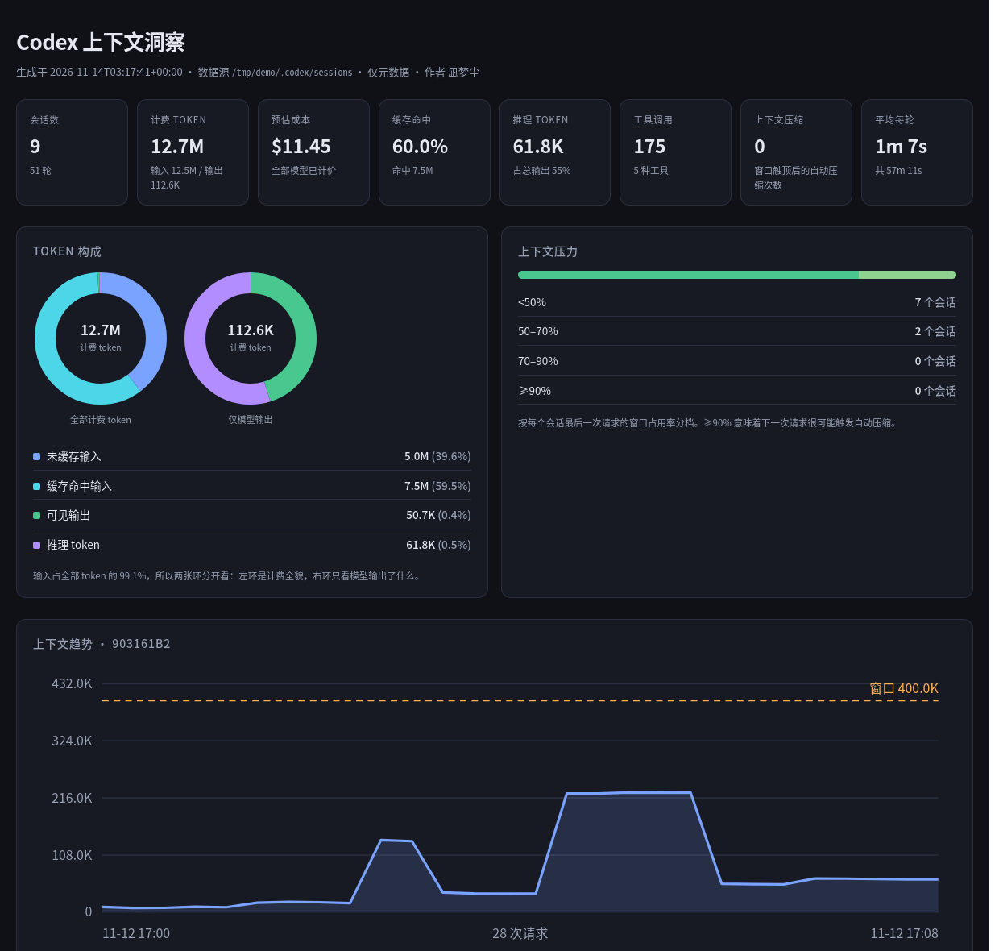

# 上下文洞察 · codex-context-insight

> 作者：**凪梦尘**

[](LICENSE)
[](https://www.python.org/)
[](#)
[](#三个必须说清的前提)

给 Codex 桌面软件的上下文洞察插件。看每次会话烧了多少 token、上下文窗口占了多少、花了多少钱、时间都花在哪。

以 DeepSeek Harness 的 `dsh-context` 为蓝本——你在 DSH 里习惯的那套「上下文可见性」，搬到 Codex 上。



## 给非技术用户

不熟悉命令行?看 [使用说明](docs/使用说明.md) —— 从装到用,一步步,含「看到每个数字是什么意思」。

## 它解决什么问题

Codex 跑久了，你会遇到三个说不清的问题：

1. **这个会话上下文占了多少？** 快到窗口上限了没有？该开新会话还是继续？
2. **钱花在哪了？** 哪个会话最贵、哪一天用量最大、缓存到底有没有生效？
3. **时间花在哪了？** 是在等模型生成，还是在等工具跑完？
4. **Agent 到底干了什么？** 调了多少次 shell、多少次改文件？

Codex 自己会把这些写进磁盘，但没人替你看。这个插件替你把它变成一张能读懂的报告。

## 三个必须说清的前提

### 一、它只读元数据

读的是 **token 数、模型名、工具名、时间戳**。

**不读**：你的提示词正文、模型的回答、工具调用的参数、工具的输出。

这不是配置项，是写死在解析器里的边界——`context_core.py` 根本不会把那些字段取出来。测试里专门有一条用例把假密钥塞进提示词和参数，断言它们进不了任何数据结构。

### 二、它不联网

纯本地 Python 标准库，没有第三方依赖，不发任何网络请求。报告是一张自包含的 HTML，双击就能看。

### 三、成本是估算，不是账单

按公开单价算。模型不在价格表里时，显示 `—` 而不是猜一个数字。要精确金额，以 OpenAI 账单为准。

## 快速开始

```bash
git clone https://github.com/AronRolstonAlex/codex-context.git
cd codex-context
python3 install.py          # 装到 ~/.codex
```

然后**完全退出重开 Codex** → Plugin Directory → 「本机插件」→ 安装。

不想装插件，只想先看一份报告：

```bash
python3 scripts/report.py --out ~/codex-context-report.html
```

## 装到 Codex 上

需要 **Python 3.9+**（Codex 钩子本来就用 python 脚本，通常已经有）。

### 一键安装

把整个插件目录拷到目标电脑，进目录执行：

```bash
python3 install.py
```

它会：
- 复制插件到 `~/.codex/plugins/codex-context-insight/`
- 在 `~/.agents/plugins/marketplace.json` 登记一个「本机插件」市场

**先看会写什么、不实际写入**：

```bash
python3 install.py --dry-run
```

`CODEX_HOME` 不是默认值时：

```bash
python3 install.py --codex-home D:/codex-home
```

### 装完必做的三步

1. **完全退出并重开 Codex 桌面应用**——marketplace 只在启动时扫描
2. 打开 **Plugin Directory** → 选 **本机插件** → 安装 `codex-context-insight`
3. 首次跑到钩子时 Codex 会让你**审阅并信任**——插件自带的钩子默认不被信任，这是 Codex 的安全设计，不是故障

### 卸载

```bash
python3 install.py --uninstall
```

删掉插件目录与 marketplace 条目。已经生成的报告文件、钩子的信任记录需要你手动清。

## 怎么用

### 平时：什么都不用做

钩子在 `SessionStart` / `Stop` / `PreCompact` / `SessionEnd` 自动刷新报告，最多每 120 秒重建一次（防止一个长会话把 CPU 拖死）。

报告位置：插件数据目录下的 `report.html`。

### 想立刻看：手动跑

```bash
python3 ~/.codex/plugins/codex-context-insight/scripts/report.py --out ~/codex-context-report.html
```

打开那个 HTML 就是完整报告。

### 只要数字，不要文件

```bash
python3 scripts/report.py
```

终端直接打印：会话数、token、成本、缓存命中率、模型分布、工具分布。

### 在 Codex 里问

装好后可以直接说：

> 看一下我最近的 token 用量和成本

Codex 会调用 `context-insight` 技能生成报告。

## 报告里有什么

| 区块 | 回答的问题 |
| --- | --- |
| **KPI 横条** | 会话数、轮次、计费 token、预估成本、缓存命中率、推理 token、工具调用数、上下文压缩次数、活跃时长 |
| **Token 构成（双环）** | 左环看计费全貌（未缓存输入 / 缓存命中输入 / 可见输出 / 推理）；右环只看模型输出，拆成「写出来的」和「想出来的」 |
| **上下文压力** | 每个会话离窗口上限还有多远，分 <50% / 50–70% / 70–90% / ≥90% 四档，≥90% 意味着下次请求很可能触发自动压缩 |
| **上下文趋势** | 逐次请求的上下文占用曲线，叠加窗口上限。纵轴按数据自适应，峰值远低于窗口时窗口以标注形式给出真实占比，不会被压成一条贴底的平线 |
| **耗时统计** | 轮次总耗时拆成「模型工作时间」与「工具执行时间」的堆叠条；四个统计行（轮次总耗时 / 工具总耗时 / 平均每轮 / 平均每工具）；按工具的执行耗时排行；最慢的 5 个轮次 |
| **按日用量** | 最近 14 天的 token 柱状图，悬停显示当天成本与会话数 |
| **模型分布** | 哪个模型承担多少轮次 |
| **工具调用** | shell / apply_patch / MCP 工具各被调了多少次 |
| **对话解剖** | 用户消息、助手消息、推理条目、工具调用、工具结果各多少条（只有计数，没有内容） |
| **会话明细** | 每个会话的模型、目录、轮次、请求数、token、成本、峰值/窗口、压缩次数、当前占用率 |

**当前占用率**用颜色分级：绿色 < 70%，黄色 70–90%，红色 ≥ 90%。红了就该考虑开新会话。

## 数据从哪来

Codex 把每个会话写成一个 JSONL：

```
$CODEX_HOME/sessions/YYYY/MM/DD/rollout-<时间戳>-<会话uuid>.jsonl
```

一个会话一个文件，放在它**开始那天**的目录里。

插件读其中的：
- `session_meta` / `turn_context` → 会话 id、工作目录、模型
- `token_count` → token 累计值、上下文窗口、当前占用
- `response_item` 里的工具调用 → **只取工具名**，参数丢弃
- `task_started` / `user_message` / `context_compacted` → 轮次、提示数、压缩次数

这个格式 Codex 没有公开为稳定接口，所以解析器对每一行都是防御式读取：**不认识的行记个数就跳过，永不报错**。报告底部会列出「未识别但已安全跳过的行类型」，让你知道解析覆盖率。

## 口径细节（别人问你时照这个说）

- **token 取累计快照，不求和。** Codex 的 `total_token_usage` 本身就是累计值，求和会重复计算。取最后一个事件。
- **上下文窗口以 Codex 上报为准。** 优先用 `model_context_window`；只有它缺失时，才用内置默认表兜底。
- **缓存命中率 = 缓存输入 / 总输入。** 命中率高说明前缀复用得好。
- **一个会话可能有多个模型**（中途切换），报告取占轮次最多的那个作为主模型。
- **累计快照 ≠ 窗口占用。** Codex 的 `total_token_usage.input` 是所有请求的累计和，拿它算占用率会被封顶到 100%。窗口占用只用「每次请求携带的输入」（`last_token_usage.input`），因为每轮都会重发整个窗口。
- **上下文占用的两个来源**：Codex 有 `context_tokens` 时优先用它；没有时用每轮请求的输入量推导——这是 dsh-context 所说的「当前上下文」的等价量。
- **耗时来自 Codex 自己的时间戳**，不是估算：
  - 轮次耗时 = `task_started.started_at` → `task_complete.completed_at`（epoch 秒）；有 `duration_ms` 时以它为准。
  - 工具耗时 = 调用那一行 → 它的 `call_id` 对应的结果行。
  - **模型工作时间 = 轮次耗时 − 工具耗时**。这是 dsh-context 那张耗时卡的等价量：轮次墙钟时间里，扣掉工具在跑的部分，剩下的就是模型在思考、生成、传输。
  - 没有配对到结果的工具调用**不计时**，以免把未完成的调用算成瞬间完成。

## 报告做不到的事（如实说明，不编造）

Codex 的 rollout 不记录以下数字，所以报告里**没有**这些区块。这不是遗漏，是数据不存在：

- **系统提示词 / 工具定义 / 注入上下文的分别占比**：Codex 只记合计输入，不拆分类别。dsh-context 的六色堆叠条在 Codex 上无法复现。
- **首 token 时间（TTFB）**：rollout 记录的是每个事件的完成时刻，看不到流式首包。
- **命令行文本明细**：插件只保留程序名计数，不读参数（隐私决定）。

## 出问题怎么办

| 现象 | 原因 | 处理 |
| --- | --- | --- |
| 报告说没有会话 | 这台机器还没跑过 Codex，或 `CODEX_HOME` 不是默认值 | 用 `--codex-home` 指过去 |
| 成本全是 `—` | 模型不在价格表里 | 有意为之，不猜数字；要加就在 `context_core.py` 的 `PRICE_TABLE` 补一行 |
| 数字比预期少 | 只算了最近 30 个会话 | 加 `--limit 0` 看全部 |
| 钩子没生效 | 插件钩子默认不被信任 | 在 Codex 里审阅并信任；或直接手动跑 report.py |
| 装完 Plugin Directory 里看不到 | 没重启 Codex | 完全退出再打开 |

## 文件结构

```
codex-context-insight/
├── plugin.json                    插件清单（Agent Plugins schema）
├── install.py                     安装 / 卸载
├── scripts/
│   ├── context_core.py            解析与统计（唯一的真相源）
│   └── report.py                  生成 HTML / JSON / Markdown
├── hooks/
│   ├── hooks.json                 钩子注册
│   └── session_report.py          钩子入口（永不失败）
├── skills/context-insight/
│   └── SKILL.md                   让 Codex 会说「生成报告」
├── assets/                        图标
├── docs/
│   ├── report.png                 报告截图
│   └── 使用说明.md                 给使用者的完整说明书
├── LICENSE
└── tests/test_context.py          26 个测试
```

## 自测

```bash
python3 -m unittest discover -s tests -v
```

覆盖四件不能丢的事：**只读元数据**、**累计值不重复计算**、**耗时来自真实时间戳**、**坏数据不崩**。

## 想改

- **加模型价格**：`scripts/context_core.py` 的 `PRICE_TABLE`
- **改默认上下文窗口**：同文件的 `DEFAULT_CONTEXT_WINDOWS`
- **改报告外观**：`scripts/report.py` 的 `CSS`
- **改刷新频率**：`hooks/session_report.py` 的 `REBUILD_INTERVAL_SECONDS`

改完不用重新安装——但装在 `~/.codex/plugins/` 下的是副本，要改副本或重新装一次。

## 许可

MIT · 作者：**凪梦尘**
